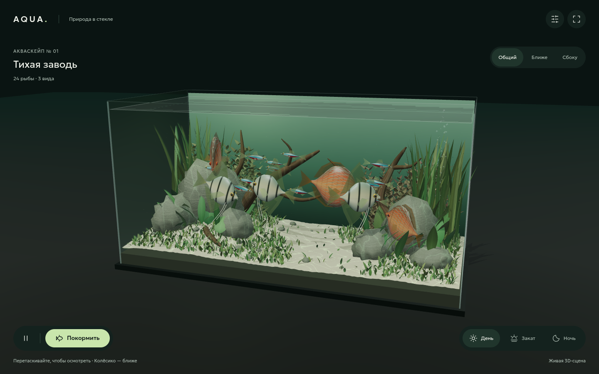

# AQUA · GPT-6 xhigh

Интерактивный 3D-аквариум как демонстрация работы GPT-6 в режиме **xhigh** по короткому запросу на русском языке. Модель и режим указаны автором эксперимента.

**[Скачать готовый HTML](https://github.com/Afapoid/gpt-6-xhigh-aquarium/releases/latest/download/aquarium.html)** · **[Релизы](https://github.com/Afapoid/gpt-6-xhigh-aquarium/releases)** · **[Исходный промпт](PROMPT.md)**



## Промпт

Запрос сохранён дословно:

> сделай 3D HTML аквариум с реалистичными и прорабоннами рыбами водой и rtx отражениями травой и декорациями. Рыбы должны быть качественные и реалистичные.

## Результат

- **24 объёмные рыбы:** 3 дискуса, 3 скалярии и 18 неонов. Отдельные глаза, плавники и хвосты, текстуры чешуи и жаберных крышек.
- **Акваскейп:** песок, камни, ветвистые коряги, колышущаяся растительность и пузырьки.
- **Свет и вода:** отражения сцены в реальном времени, преломление в боковых стёклах, тени и анимированная каустика.
- **Взаимодействие:** кормление привлекает рыб; доступны пауза, свободная камера, готовые ракурсы, день, закат и ночь.
- **Один автономный HTML:** библиотеки и шрифты встроены, геометрия и текстуры создаются программно. Интернет при просмотре не нужен.

Упомянутый в промпте RTX реализован как приближение средствами **Three.js / WebGL 2**: отражение отдельной камерой и эффекты материалов. Аппаратной трассировки лучей RTX/path tracing здесь нет. Рыбы и окружение — процедурные модели; степень реализма можно оценить по скриншоту и работающей сцене.

## Запуск

1. Скачайте `aquarium.html` из релиза.
2. Откройте файл в браузере с WebGL 2 и поддержкой import maps. Автономный запуск проверен в Chrome.
3. Вращайте камеру перетаскиванием, приближайте колёсиком или жестом щипка. С клавиатуры: фокус на сцене, стрелки и `+` / `−`.

На слабом устройстве выберите экономное качество в настройках. При системной настройке уменьшения движения аквариум запускается на паузе; кнопка воспроизведения запускает симуляцию.

## Как получен результат

Исходный творческий запрос приведён выше. После прерывания сессии пользователь отправил «продолжи». Агент создавал код, несколько раз дорабатывал геометрию и материалы, проверял сцену в Chrome и собирал автономный файл. В окружении применялся навык `better-design`.

Этот репозиторий фиксирует один конкретный результат такого рабочего процесса. Он не является сравнительным бенчмарком моделей. Подробности оформления и проверки: [DESIGN.md](docs/DESIGN.md), [QA.md](docs/QA.md).

## Исходники

```text
aquarium.html          автономная сборка
dist/index.html        страница приложения
dist/app.js            геометрия, материалы, анимация и управление
dist/style.css         интерфейс
dist/vendor/           Three.js и сторонние лицензии
build-standalone.py    сборка одного HTML без npm
PROMPT.md              исходный запрос и контекст эксперимента
docs/                  скриншот, дизайн и результаты проверки
```

Для изменения исходников:

```sh
git clone https://github.com/Afapoid/gpt-6-xhigh-aquarium.git
cd gpt-6-xhigh-aquarium
python3 -m http.server 4175 --bind 127.0.0.1 --directory dist
```

Откройте `http://127.0.0.1:4175`. После изменений пересоберите автономный файл:

```sh
python3 build-standalone.py
```

## Зависимости

Three.js **0.170.0** — [MIT](dist/vendor/THREE-LICENSE.txt); контуры иконок Lucide — [ISC](dist/vendor/LUCIDE-LICENSE.txt); Geologica — [SIL Open Font License](dist/vendor/GEOLOGICA-LICENSE.txt). Библиотеки размещены локально. Встроенные лицензии также сохранены внутри автономного HTML.
